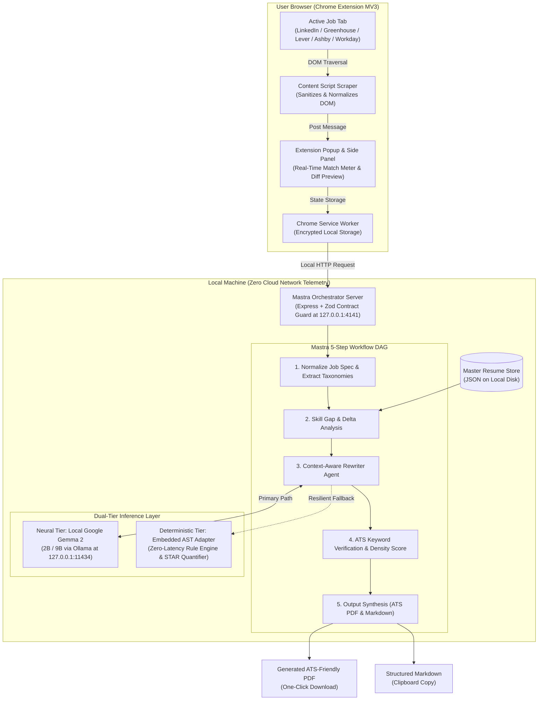
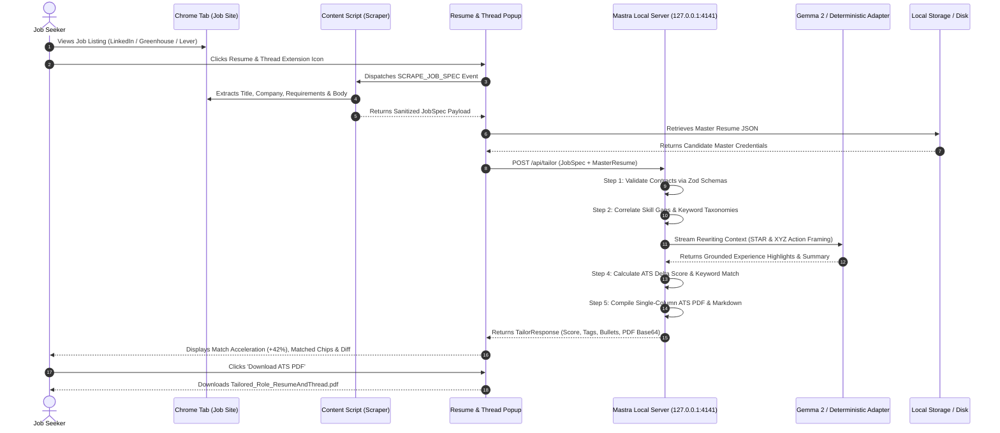
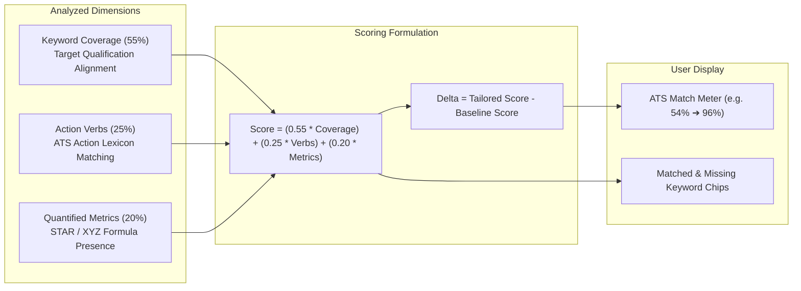
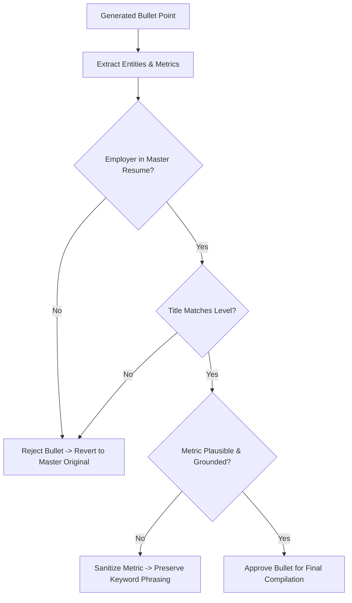

<div align="center">
  
  <h1>Resume & Thread</h1>
  <p><strong>The Local-First Bespoke Resume Tailorer</strong></p>
  <p><em>Craftsmanship, Local Execution Threads, and Zero-Cloud Data Sovereignty</em></p>

[](LICENSE)
[](extension/manifest.json)
[](https://mastra.ai)
[](https://ai.google.dev/gemma)
[]()
[]()

</div>

> **Bespoke Career Craftsmanship Without the SaaS Rent.**  
> Scrapes job requirements directly from job portals (LinkedIn, Indeed, Greenhouse, Lever, Ashby, Workday), correlates them with your local Master Resume, and uses Google Gemma orchestrated via Mastra on your local machine to tailor, ATS-optimize, and compile professional resumes in seconds.

---

## 1. What "Resume & Thread" Signifies

The name **Resume & Thread** brings together three core dimensions of the system:

1. **Bespoke Tailoring Craftsmanship (The Needle & Thread)**  
   Inspired by Savile Row bespoke tailoring. Off-the-rack suits—and generic resumes—never fit properly. A master tailor takes quality raw fabric (your career history), measures the specifications of the occasion (the target job description), and cuts and stitches a custom garment. Resume & Thread applies this bespoke philosophy to career documents: precise, high-craft, and fitted to the role.

2. **Concurrency & Local Architecture (Execution Threads)**  
   In systems engineering, a *thread* is the fundamental unit of concurrent CPU/GPU execution. Resume & Thread runs completely locally on your hardware’s native threads. No cloud servers, no third-party API keys, and no personal data transmission.

3. **The Common Narrative Thread**  
   Every professional career has an underlying "golden thread"—the core narrative of problem solving, leadership, and technical capability. Resume & Thread draws out this continuous narrative thread to highlight relevant accomplishments without fabricating falsehoods.

---

## 2. System Architecture



---

## 3. End-to-End Sequence Flow



---

## 4. ATS Scoring Math & Verification Engine

The ATS scoring formula evaluates four weighted dimensions:



---

## 5. Anti-Hallucination Grounding Rule-Set



---

## 6. Quick-Start Guide

### Prerequisites
1. **Node.js** (v18.0.0 or higher)
2. *(Optional for Neural Weights)* **Ollama** installed with Gemma 2:
   ```bash
   ollama pull gemma2:2b
   ```

### 1. Launch the Local Mastra Engine
```bash
cd server
npm install
npm run build
npm start
```
*The local orchestration engine initializes on `http://127.0.0.1:4141`.*

### 2. Load the Chrome Extension
1. Open Google Chrome and navigate to `chrome://extensions/`.
2. Enable **Developer mode** in the top-right corner.
3. Click **Load unpacked** and select the [`extension/`](extension) folder from this repository.
4. Pin **Resume & Thread** to your toolbar.

### 3. Add Your Master Resume
1. Click the Resume & Thread icon and open **Settings** (or edit `server/data/master_resume.json`).
2. Paste or edit your comprehensive Master Resume containing all past roles, achievements, and technical skills.

### 4. Tailor & Apply
1. Navigate to any job posting on LinkedIn, Indeed, Greenhouse, Lever, Ashby, or Workday.
2. Click **Resume & Thread**.
3. Inspect the live ATS Match Score and download your freshly tailored PDF or Markdown resume in seconds.

---

## 7. Documentation Architecture

Comprehensive engineering specifications are located in the [`/docs`](docs) directory:

- [01 - Project Overview & Strategic Foundation](docs/01-project-overview.md)
- [02 - Technical Architecture & Stack](docs/02-architecture.md)
- [03 - Privacy & Zero-Cloud Security Blueprint](docs/03-privacy-and-security.md)
- [04 - Mastra & Gemma Integration Specification](docs/04-mastra-gemma-integration.md)
- [05 - ATS Scoring Formula & Heuristics](docs/05-ats-scoring-engine.md)
- [Unified Phased Platform Roadmap (v1.0 to v3.0)](docs/roadmap/unified-platform-roadmap.md)
- [Component Specifications](docs/components/)
- [Local REST & WebSocket API Specification](docs/api/local-server-api.md)
- [Security Threat Model & Mitigations](docs/security/threat-model.md)
