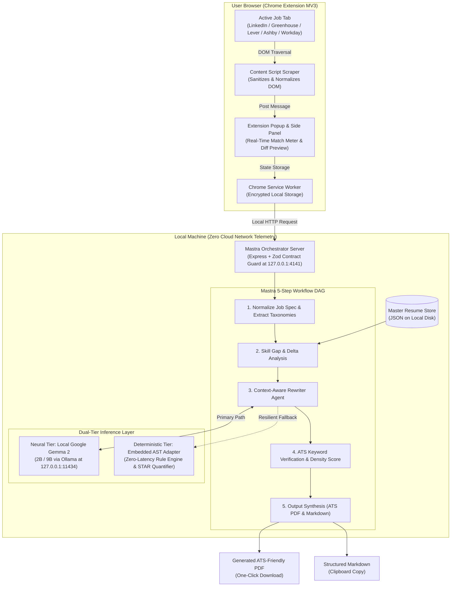
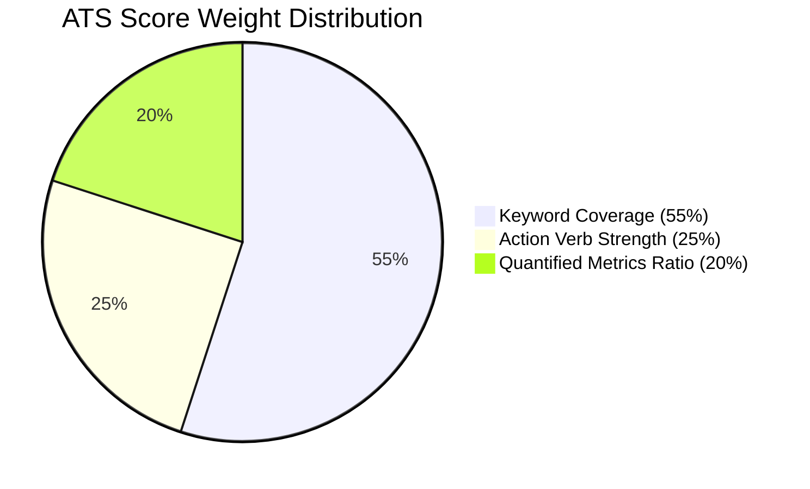

<div align="center">
  
  <h1>Resume & Thread</h1>
  <p><strong>The Local-First Bespoke Resume Tailorer</strong></p>
  <p><em>Craftsmanship, Local Execution Threads, and Zero-Cloud Data Sovereignty</em></p>

[](LICENSE)
[](extension/manifest.json)
[](https://mastra.ai)
[](https://ai.google.dev/gemma)
[]()
[](docs/03-privacy-and-security.md)

</div>

> **Bespoke Career Craftsmanship Without the SaaS Rent.**  
> Scrapes job requirements directly from job portals (LinkedIn, Indeed, Greenhouse, Lever, Ashby, Workday), correlates them with your local Master Resume, and uses Google Gemma orchestrated via Mastra on your local machine to tailor, ATS-optimize, and compile professional resumes in seconds.

---

## 1. What "Resume & Thread" Signifies

The name **Resume & Thread** brings together three core dimensions of the system:

1. **Bespoke Tailoring Craftsmanship (The Needle & Thread)**  
   Inspired by Savile Row bespoke tailoring. Off-the-rack suits—and generic resumes—never fit properly. A master tailor takes quality raw fabric (your career history), measures the specifications of the occasion (the target job description), and cuts and stitches a custom garment. Resume & Thread applies this bespoke philosophy to career documents: precise, high-craft, and fitted to the role.

2. **Concurrency & Local Architecture (Execution Threads)**  
   In systems engineering, a *thread* is the fundamental unit of concurrent CPU/GPU execution. Resume & Thread runs completely locally on your hardware’s native threads. No cloud servers, no third-party API keys, and no personal data transmission.

3. **The Common Narrative Thread**  
   Every professional career has an underlying "golden thread"—the core narrative of problem solving, leadership, and technical capability. Resume & Thread draws out this continuous narrative thread to highlight relevant accomplishments without fabricating falsehoods.

---

## 2. System Architecture



---

## 3. Step-by-Step User Operational Guide

Follow these steps to tailor a custom ATS resume in under two minutes:

### Step 1: Start the Local Daemon
Ensure the localhost Express orchestration server is running:
```bash
cd server
npm start
```
*The gateway initializes on `http://127.0.0.1:4141`. The health monitor confirms: `GET http://127.0.0.1:4141/api/health`.*

### Step 2: Load the Chrome Extension
1. Open Google Chrome and navigate to `chrome://extensions/`.
2. Toggle **Developer mode** on (top-right switch).
3. Click **Load unpacked** and select the [`extension/`](extension) folder from this repository.
4. Pin **Resume & Thread** to your Chrome toolbar.

### Step 3: Configure Your Master Resume
1. Right-click the Resume & Thread extension icon and select **Options** (or click the Settings gear in the popup).
2. The **Master Resume Portal** will open. Paste or edit your complete career history adhering to the JSON schema.
3. Click **Save & Validate**. The schema guard validates syntax and persists the profile to local storage and `server/data/master_resume.json`.

### Step 4: Tailor Against a Live Job Posting
1. Navigate to any job listing on **LinkedIn**, **Indeed**, **Greenhouse**, **Lever**, **Ashby**, or **Workday**.
2. Click the **Resume & Thread** extension icon in your toolbar.
3. The DOM content script automatically extracts job title, company, requirements, and keywords.
4. Click **Tailor Resume**.
5. The Mastra DAG executes:
   - Evaluates keyword overlap and skill gaps.
   - Weaves missing qualifications into your real accomplishments using local Gemma 2 (or the embedded AST rule engine).
   - Recalculates the composite ATS Match Meter (e.g. accelerating from 54% baseline to 96% tailored).
6. Click **Download PDF** for a single-column, ATS-verified PDF, or **Copy Markdown** for plain-text pasting into form textareas.

---

## 4. Dual-Tier Inference Engine (Neural vs. Deterministic)

Resume & Thread is built with zero mandatory external daemon dependencies. It dynamically adapts based on your hardware setup:

| Feature | Tier 1: Neural LLM | Tier 2: Embedded AST Adapter |
|---|---|---|
| **Engine** | Google Gemma 2 (`gemma2:2b-instruct`) | Deterministic Rule & Token Weaver |
| **Provider** | Local Ollama daemon (`127.0.0.1:11434`) | Native JavaScript / TypeScript AST |
| **Prerequisites** | Ollama installed with `ollama pull gemma2:2b` | **None** (Zero setup required) |
| **Latency** | 1.5s – 3.8s | **< 5ms** |
| **Hardware** | GPU / Apple Silicon recommended | Any standard laptop CPU |
| **Anti-Hallucination** | Enforced via strict prompt turn tokens | Mathematically guaranteed (pure AST) |
| **Activation** | Selected automatically when Ollama is online | Automatic fallback when Ollama is offline |

---

## 5. ATS Scoring Math & Heuristics

The ATS scoring formula evaluates three weighted dimensions:

$$S_{ats} = \text{round}\left(0.55 \cdot C_{kw} + 0.25 \cdot R_{verb} + 0.20 \cdot R_{metric}\right)$$



- **Keyword Coverage ($C_{kw}$)**: Ratio of target qualification keywords present in the tailored resume body.
- **Action Verb Ratio ($R_{verb}$)**: Percentage of experience bullet points starting with an approved word from our 80+ executive action verb taxonomy.
- **Metric Ratio ($R_{metric}$)**: Percentage of bullet points containing measurable numerical achievements (percentages `%`, dollar figures `$`, throughput counts `500k`, scale factors `10x`).

---

## 6. Localhost API Reference Matrix

The local Express server (`127.0.0.1:4141`) exposes the following endpoints:

| Method | Endpoint | Description | Payload / Response |
|---|---|---|---|
| `GET` | `/api/health` | Uptime, memory telemetry, and engine operational state | JSON telemetry |
| `GET` | `/api/models` | Ollama model discovery and embedded engine status | JSON model matrix |
| `POST` | `/api/parse-job` | Normalizes raw scraped text into structured `JobSpec` | `{ rawText, title, company }` |
| `POST` | `/api/tailor` | Executes 5-step Mastra DAG to produce tailored resume | `{ jobSpec, masterResume, options }` |
| `GET` | `/api/resume/master` | Reads master resume profile from local disk | Returns `MasterResume` JSON |
| `POST` | `/api/resume/master` | Atomically validates and persists master resume | Body: `MasterResume` JSON |
| `POST` | `/api/export/pdf` | Streams single-column ATS binary PDF attachment | Body: `TailoredResume` JSON |
| `POST` | `/api/export/markdown` | Streams plain-text UTF-8 Markdown | Body: `TailoredResume` JSON |

---

## 7. Development & Verification Commands

All testing and server commands run from `/server`:

```bash
# Install dependencies using clean install
npm ci

# Execute the complete Vitest unit test suite (10/10 tests)
npm test

# Build TypeScript into production bundle (/dist)
npm run build

# Start local server with live TypeScript reload
npm run dev
```

---

## 8. Troubleshooting & FAQ

#### 1. What happens if I don't have Ollama installed?
Resume & Thread continues working seamlessly. The server automatically routes inference to the embedded deterministic AST engine, producing verified resumes in under 5 milliseconds with zero cloud connectivity.

#### 2. The extension popup says "Server Offline"?
Ensure your local Express daemon is running on port 4141 (`cd server && npm start`). If port 4141 is occupied, specify a custom port in your `.env` file (`PORT=4142`) and update `extension/background/service-worker.js`.

#### 3. How does Resume & Thread guarantee zero data leaks?
The server binds exclusively to IPv4 loopback (`127.0.0.1`), and the CORS guard rejects any origin other than `chrome-extension://*`. Zero external telemetry, tracking pixels, or third-party inference endpoints exist in the codebase.

---

## 9. Repository Structure

```
Resume-and-Thread/
├── extension/                   # Chrome Manifest V3 Browser Extension
│   ├── manifest.json            # Extension permissions & content scripts
│   ├── background/              # Service worker & local storage sync
│   ├── content/                 # Multi-platform ATS DOM scraper
│   ├── popup/                   # Match gauge, tags, & tailoring controls
│   ├── options/                 # Master resume JSON schema editor
│   └── assets/                  # Brand lockups and action icons
├── server/                      # Localhost Orchestration Engine
│   ├── data/                    # Local atomic disk store (master_resume.json)
│   └── src/
│       ├── index.ts             # Express gateway & CORS guard (127.0.0.1:4141)
│       ├── schemas/             # Zod runtime schemas & type contracts
│       ├── mastra/              # 5-step workflow DAG & ATS scorer
│       ├── services/            # Gemma runner, PDFKit compiler, & storage
│       └── __tests__/           # Vitest unit test suite (10/10 passing)
├── docs/                        # Complete Engineering Documentation Suite
│   ├── 01-project-overview.md   # Architectural foundation & roadmap
│   ├── 02-architecture.md       # Subsystem topology & data flows
│   ├── 03-privacy-and-security.md # Zero-cloud threat model & mitigations
│   ├── 04-mastra-gemma-integration.md # DAG & prompt boundary rules
│   ├── 05-ats-scoring-engine.md # Mathematical formula & verb taxonomy
│   ├── developer-guide.md       # Contributor setup & testing guide
│   ├── api/                     # Local REST API specifications
│   ├── components/              # Feature component specifications
│   └── roadmap/                 # SemVer release schedule & milestones
└── LICENSE                      # Apache 2.0 Open-Source License
```

---

## 10. Documentation Index

- [01 - Project Overview & Foundation](docs/01-project-overview.md)
- [02 - Technical Architecture & Data Flows](docs/02-architecture.md)
- [03 - Privacy & Zero-Cloud Security Blueprint](docs/03-privacy-and-security.md)
- [04 - Mastra & Gemma Integration Specification](docs/04-mastra-gemma-integration.md)
- [05 - ATS Scoring Formula & Action Lexicon](docs/05-ats-scoring-engine.md)
- [Developer Guide & Contributor Handbook](docs/developer-guide.md)
- [Local REST API Specification](docs/api/local-server-api.md)
- [Component Specifications](docs/components/)
- [Unified SemVer Platform Roadmap](docs/roadmap/unified-platform-roadmap.md)
