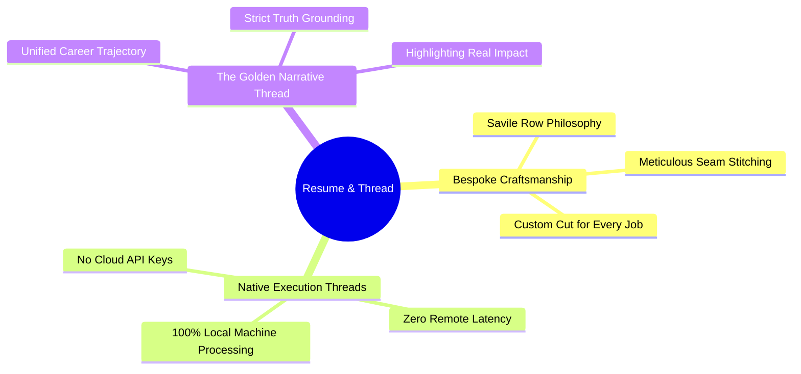

  

# Resume & Thread: Project Overview & Strategic Foundation

## 1. Executive Summary

**Resume & Thread** is a high-speed, privacy-first, local-orchestrated browser extension and backend designed for job seekers navigating high-volume application cycles. It automates the repetitive process of tailoring resumes to pass corporate Applicant Tracking Systems (ATS) while guaranteeing that **not a single byte of sensitive personal information leaves the user's local machine**.

By pairing a lightweight Chrome Extension (Manifest V3) with a local orchestrator powered by **Mastra** and open-weight models (**Google Gemma 2**), Resume & Thread achieves what commercial SaaS tools cannot: **instantaneous tailoring, absolute privacy, and zero recurring subscription cost**.

---

## 2. The Core Significance of "Resume & Thread"

The name unites three distinct principles:
1. **The Needle & Thread of Bespoke Tailoring**: Just as a Savile Row master tailor custom-cuts high-grade fabric for a specific occasion, Resume & Thread tailors your comprehensive career record into an exact fit for a target job specification.
2. **Local CPU/GPU Execution Threads**: The software runs natively on local threads without external cloud dependencies.
3. **The Common Narrative Thread**: It highlights the candidate's authentic transferable skills and impact metrics across roles.

---

## 3. Market Comparison

| Capability / Dimension | Commercial SaaS (Jobscan, Teal) | Resume & Thread (Local) |
|---|---|---|
| **Monthly Cost** | $19 – $39 / month recurring | **$0.00 forever** (Open-source) |
| **Personal Data Privacy** | Full work history, address, phone sent to cloud DBs | **100% Local**: Stays on user's device |
| **Application Speed** | Manual copy-paste, 3–5 min per job | **One-Click**: Triggered directly from active tab |
| **Hallucination Control** | Prone to LLM embellishments | **Zod Contracts**: Strict factual grounding |
| **ATS Optimization** | Blind keyword stuffing | **Weighted Semantic Delta Scoring** |

---

## 4. Key Partner Alignments

### Best Use of Mastra
- **Directed Acyclic Graph (DAG) Workflows**: Chains entity extraction, gap analysis, constrained bullet rewriting, and scoring into a deterministic pipeline.
- **Typed Zod Schemas**: Strict contract enforcement across all inputs and outputs.
- **Local Tooling Architecture**: Modular local tools for heuristic keyword analysis, PDF synthesis, and file storage.

### Best Use of Gemma
- **High-Efficiency Open Weights**: Leverages Google's Gemma 2 (2B for sub-second latency; 9B for deep narrative nuance).
- **Consumer Hardware Execution**: Runs completely on local Apple Silicon (M-series) or standard PC RTX/CPU via Ollama or local llama.cpp bindings.
- **Resilient Dual-Tier Inference**: Includes an embedded deterministic AST engine to guarantee zero downtime or unreachable model errors.
