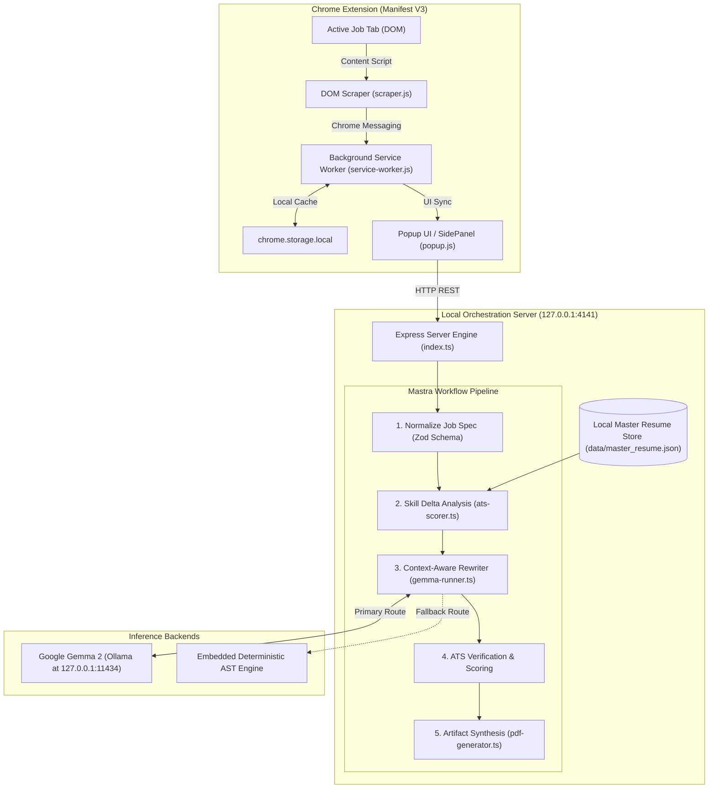
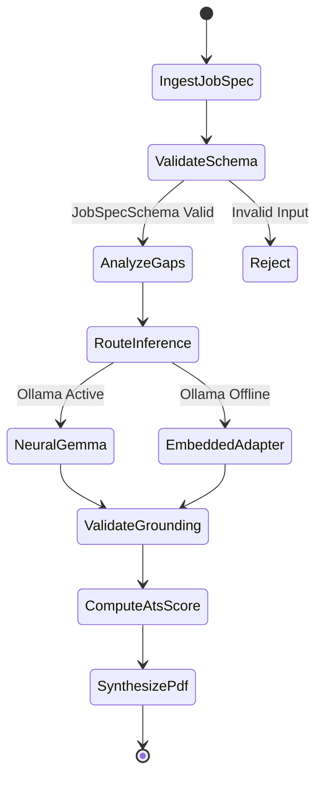

# Resume & Thread: Technical Architecture & System Specification

## 1. System Topology Overview

Resume & Thread is structured around a two-tier decoupled local architecture:
1. **Frontend Presentation & Ingestion Layer**: A Manifest V3 Chrome Extension operating in the user's browser.
2. **Local Orchestration & Inference Engine**: A Node.js backend powered by Mastra communicating directly with a local open-weight model runner (Ollama / llama.cpp) running Google Gemma 2, backed by an embedded deterministic adapter.

---

## 2. Browser Extension Layer (Manifest V3)

### 2.1 Content Script Scraper (`scraper.js`)
Injected into designated career portals with site-specific DOM heuristics:
- **LinkedIn**: `.jobs-description-content__text`, `.job-details-jobs-unified-top-card__job-title`
- **Greenhouse**: `#content`, `.job-post`
- **Lever**: `.posting-headline`, `.posting-requirements`
- **Indeed**: `#jobDescriptionText`, `.jobsearch-JobInfoHeader-title`
- **Ashby**: `[data-testid="job-details"]`
- **Workday**: `[data-automation-id="jobPostingDescription"]`
- **Generic Fallback**: High-density text element traversal.

### 2.2 Background Service Worker (`service-worker.js`)
- Maintains encrypted state cache in `chrome.storage.local`.
- Bridges sandboxed content scripts with `http://127.0.0.1:4141`.
- Seeds default master resume templates upon first install.

---

## 3. Local Mastra Orchestration Layer

The orchestration engine coordinates workflows with strong schema validation via Zod:

Each step produces typed artifacts adhering strictly to `TailorResponseSchema`.
