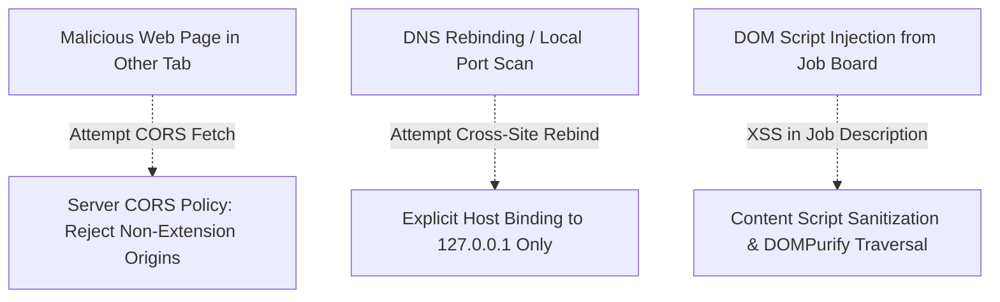

# Resume & Thread: Privacy & Zero-Cloud Security Blueprint

## 1. The Zero-Cloud PII Guarantee

Modern online resume platforms require users to upload complete personal identities: legal names, phone numbers, home addresses, current employers, and entire compensation histories. This creates high-risk honeypots vulnerable to data brokers, tracking cookies, and leaks.

```mermaid
flowchart LR
    subgraph DangerZone ["Typical Cloud SaaS Resume Wrappers"]
        UserSaaS["User Device"] -->|PII Over Public Internet| CloudSaaS["Cloud Servers\n(Third-Party Logs, DBs)"]
        CloudSaaS -->|External API Calls| CloudLLM["Proprietary Cloud LLMs\n(OpenAI / Anthropic)"]
    end

    subgraph SafeZone ["Resume & Thread Local Enclave"]
        UserSafe["User Browser"] -->|Localhost IPC (127.0.0.1)| LocalServer["Local Mastra Engine\n(Host Memory Only)"]
        LocalServer -->|Internal Socket| LocalGemma["Local Open Weights\n(Gemma 2 via Ollama)"]
    end

    style DangerZone fill:#fee2e2,stroke:#ef4444
    style SafeZone fill:#ecfdf5,stroke:#10b981
```

Resume & Thread operates on three non-negotiable security axioms:
1. **Zero External Network Calls for PII**: No candidate data is dispatched beyond `127.0.0.1`.
2. **Air-Gapped Operation**: Once model weights (`gemma2:2b`) are pulled, the system functions indefinitely without an active internet connection.
3. **User-Controlled Persistence**: The Master Resume resides solely in local browser storage (`chrome.storage.local`) and user-managed disk (`server/data/master_resume.json`).

---

## 2. Threat Modeling & Local Surface Protection



### Defense-in-Depth Protections:
- **Strict Host Binding**: The Express engine binds specifically to `127.0.0.1` rather than `0.0.0.0`, blocking exposure across local area networks (LAN).
- **CORS Allowlist**: Cross-Origin requests are restricted to `chrome-extension://*` and localhost origins.
- **Manifest V3 Isolation**: Content scripts operate within an isolated execution environment, preventing arbitrary page scripts from intercepting extension communication.
