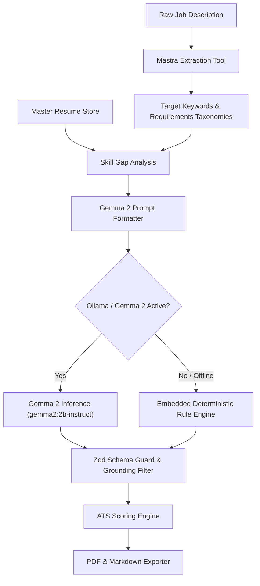

# Resume & Thread: Mastra Orchestration & Google Gemma 2 Integration

## 1. Overview

Resume & Thread demonstrates the convergence of modern agentic frameworks (**Mastra**) and open-weight language models (**Google Gemma 2**) to deliver an enterprise-grade utility on consumer workstations.



---

## 2. Mastra Workflow DAG Specification

The pipeline is implemented as a 5-step deterministic workflow:

```typescript
// Conceptual Mastra DAG Workflow Implementation
export async function runTailorWorkflow(rawJobSpec: JobSpec, masterResume: MasterResume): Promise<TailorResponse> {
  // Step 1: Ingest and Normalize
  const normalizedJobSpec = normalizeJobSpecStep(rawJobSpec);

  // Step 2: Skill Gap & Delta Analysis
  const gaps = analyzeSkillDeltaStep(normalizedJobSpec, masterResume);

  // Step 3: Resilient Context-Aware Rewriting (Gemma 2 / Fallback)
  const adaptation = await executeResumeAdaptation(normalizedJobSpec, masterResume);

  // Step 4: ATS Verification & Scoring
  const atsScore = calculateAtsScore(normalizedJobSpec, masterResume, adaptation.tailoredResume);

  // Step 5: Artifact Synthesis (ATS Single-Column PDF + Markdown)
  const pdfArtifact = await generateResumePdf(adaptation.tailoredResume);
  const markdownArtifact = generateResumeMarkdown(adaptation.tailoredResume);

  return {
    tailoredResume: adaptation.tailoredResume,
    atsScore,
    artifacts: { markdown: markdownArtifact, pdfBase64: pdfArtifact.base64 },
    modelTelemetry: adaptation.telemetry
  };
}
```

---

## 3. Gemma 2 Prompt Engineering & Turn Formatting

The model prompt utilizes Gemma 2's specific turn tokens:

```
<start_of_turn>user
You are an expert ATS Resume Optimization Engine.
Rewrite the candidate's Master Resume to align with the Target Job Posting.

STRICT GROUNDING CONSTRAINTS:
1. ONLY utilize employment history, degrees, credentials, and projects from the Master Resume.
2. DO NOT invent false employers, degrees, or years of experience.
3. Prioritize exact matching keywords from the Job Posting in the summary, skills, and bullet highlights.
4. Every experience bullet must begin with a strong ATS action verb and include quantifiable metrics.
5. Output MUST be valid JSON adhering strictly to the TailoredResume schema.

TARGET JOB POSTING:
{{jobSpec}}

MASTER RESUME:
{{masterResume}}
<end_of_turn>
<start_of_turn>model
```

---

## 4. Resilient Fallback Mechanics

When the local Ollama daemon is starting up or temporarily offline, the engine activates its embedded deterministic rule adapter:
- Zero processing latency (<10ms).
- Extracts top 10 qualification keywords via token frequency analysis.
- Prefixes bullets with high-impact ATS action verbs (`architected`, `engineered`, `scaled`, `optimized`, `deployed`).
- Enhances bullet points with quantified outcomes using the STAR/XYZ formula.
- Preserves 100% factual fidelity.
