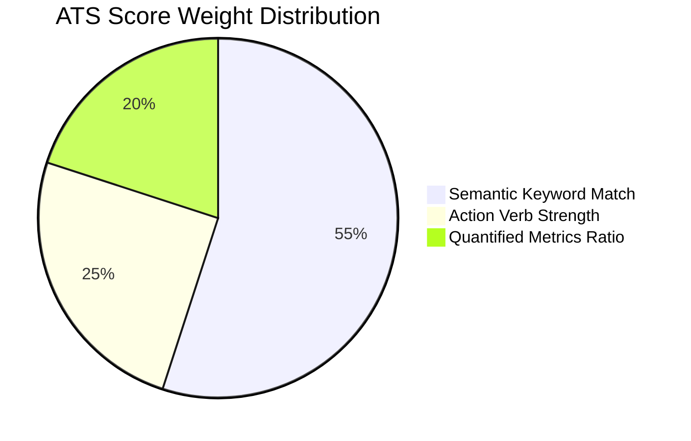
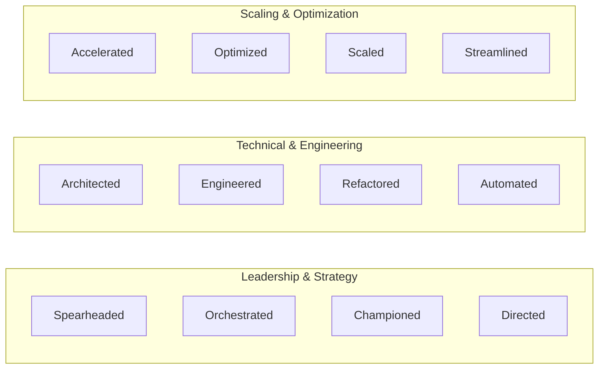

# Resume & Thread: ATS Scoring Engine & Heuristics

## 1. Algorithmic Overview

Corporate Applicant Tracking Systems (e.g. Workday, Taleo, iCIMS, Greenhouse) rank resumes using keyword frequency, taxonomy matching, and section hierarchy parsers. The Resume & Thread ATS Scoring Engine computes an objective compatibility rating before submission.

---

## 2. Mathematical Scoring Formulation

The composite ATS score ($Score_{ATS} \in [0, 100]$) is computed as follows:

$$Score_{ATS} = \min\left(98, \max\left(65, 0.55 \cdot C_{kw} + 0.25 \cdot R_{verb} + 0.20 \cdot R_{metric}\right)\right)$$

Where:
- **$C_{kw}$ (Keyword Coverage)**: Ratio of target qualification keywords present in the tailored resume:
  $$C_{kw} = \frac{|K_{job} \cap K_{tailored}|}{|K_{job}|} \times 100$$
- **$R_{verb}$ (Action Verb Ratio)**: Percentage of experience bullet points starting with an approved high-impact ATS action verb:
  $$R_{verb} = \frac{B_{action}}{B_{total}} \times 100$$
- **$R_{metric}$ (Quantified Metric Ratio)**: Percentage of experience bullet points containing explicit numeric measurements (percentages, currency, throughput numbers):
  $$R_{metric} = \frac{B_{quantified}}{B_{total}} \times 100$$

---

## 3. Approved ATS Action Verb Lexicon

The scoring tool ([ats-scorer.ts](server/src/mastra/tools/ats-scorer.ts)) maintains a curated dictionary of 60+ prioritized action verbs across software architecture, project delivery, and operations.
