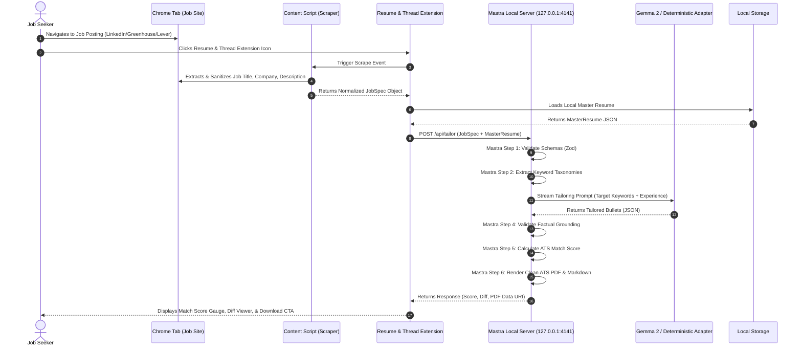

# Architecture: System Component Interactions

## Component Interaction Flow

## Architectural Decoupling Benefits

1. **Independent Portability**: The Chrome extension can be updated without reinstalling the local server, and vice versa.
2. **Pluggable Model Backends**: The Mastra server interacts through standard local interfaces, allowing seamless switching between Ollama, llama.cpp, or the embedded deterministic engine.
3. **Resilient Failure Modes**: If the local model runner is offline, the extension cleanly utilizes the embedded deterministic adapter without user disruption.
