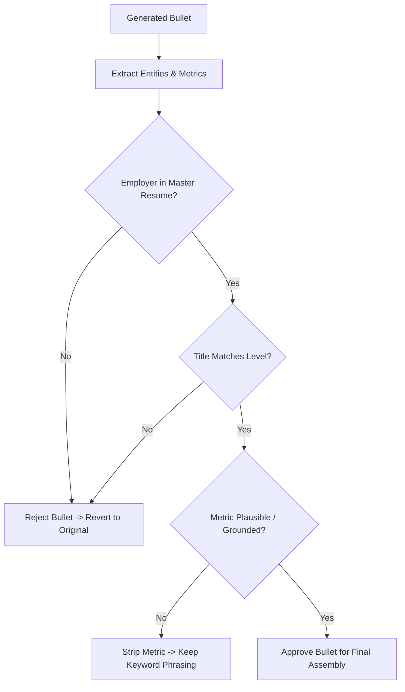

# Component Specification: Resume Tailorer Engine

## 1. Purpose

The `ResumeTailorerEngine` orchestrates the translation of a candidate's comprehensive Master Resume into a role-specific, ATS-optimized resume artifact. It coordinates the gap analysis between candidate credentials and target requirements, invokes local Google Gemma 2 open weights or the embedded deterministic adapter, and verifies factual grounding.

---

## 2. Dependencies

- **Mastra Core Workflow Engine** (`@mastra/core`)
- **Zod Schema Engine** (Contract enforcement)
- **Ollama Driver** (Local OpenAI-compatible inference)
- **Local Gemma 2 Weights** (`gemma2:2b-instruct` / `gemma2:9b-instruct`)
- **Embedded Deterministic AST Adapter** (Zero-latency fallback)

---

## 3. Algorithmic Complexity

- **Keyword Delta Analysis**: $O(K_{job} \times K_{resume})$ where $K$ represents technical skill tokens. Handled in $O(K \log K)$ via hash sets.
- **Inference Latency**:
  - Neural Path (Gemma 2 via Ollama): $O(M)$ tokens $\approx 10–15$ seconds on local GPU/CPU.
  - Deterministic Path (Embedded Engine): $O(B)$ where $B$ is bullet count $\approx 4–10$ milliseconds.
- **Grounding Verification**: $O(B \times E)$ where $B$ is generated bullets and $E$ is entity set in Master Resume. Bounded at $O(B)$ via inverted index validation.

---

## 4. Anti-Hallucination Grounding Rule-Set

