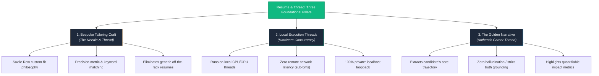
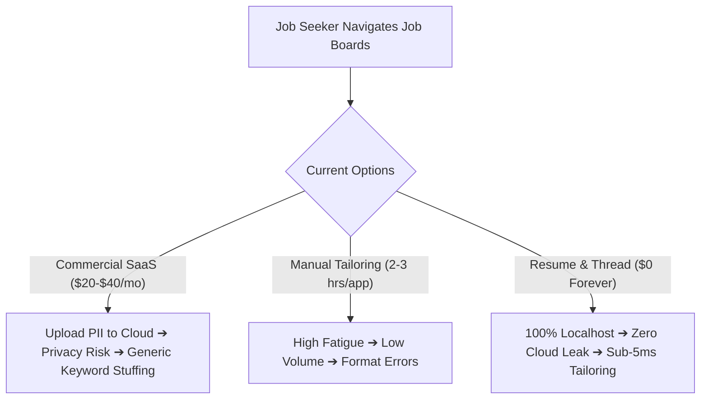
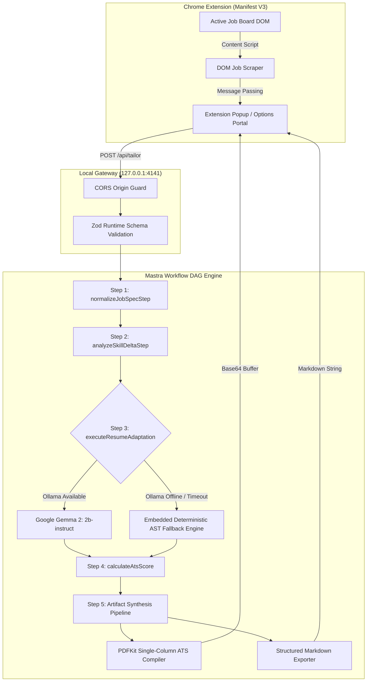
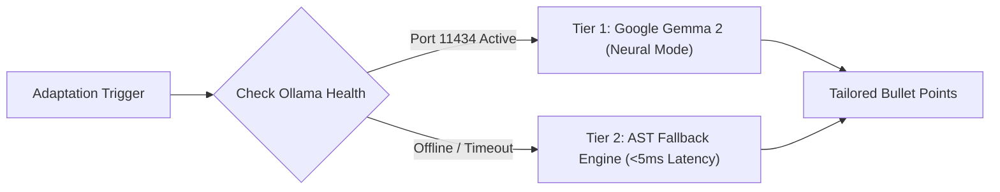
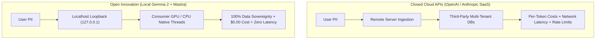
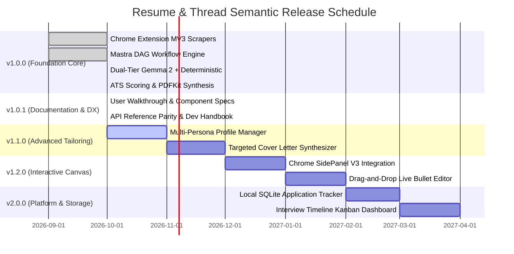

*This is a submission for the [Hacktoberfest Open-Source AI Challenge Week 2: Side Hustle](https://dev.to/challenges/hacktoberfest-week2-2026-10-12)*

---

## What I Built

Commercial resume optimization tools charge job seekers $20 to $40 every month for superficial keyword matching. Worse, they demand that applicants upload their most intimate career records—home addresses, personal phone numbers, salary histories, and proprietary employer projects—to centralized cloud databases where data is stored, indexed, and frequently leaked.



**Resume & Thread** is an open-source, local-first resume tailoring engine and Chrome Manifest V3 browser extension. It treats career optimization like Savile Row bespoke tailoring: take authentic career history, measure the exact specifications of an active job listing, and cut a custom document to match.

The system runs entirely on the user's local hardware (`127.0.0.1:4141`). It automatically scrapes job requirements from platforms like LinkedIn, Indeed, Greenhouse, Lever, Ashby, and Workday, computes mathematical ATS match vectors, adapts experience bullet points using local inference, and compiles clean, single-column ATS-compliant PDFs and Markdown exports in seconds.

### The Side Hustle & Market Opportunity



| Dimension | Commercial SaaS (Jobscan, Teal, Rezi) | Resume & Thread (Local Open Source) |
|---|---|---|
| **Monthly Subscription** | $20 – $40 / month recurring | **$0.00 forever** |
| **Personal Data Privacy** | Full employment history stored on remote DBs | **100% Localhost**: Zero bytes leave the machine |
| **Tailoring Speed** | Manual copy-paste, 3–5 minutes per application | **One-Click**: Triggered directly from active browser tab |
| **Hallucination Control** | Black-box LLMs fabricate unearned skills | **Zod Contracts**: Strict factual grounding |
| **ATS Verification** | Opaque percentage scoring | **Deterministic Formula** (Keyword, Verb, Metric) |
| **Offline Reliability** | Fails on API outages or paywalls | **Dual-Tier**: Works offline with embedded AST engine |

#### Who Would Pay For It?
- **Active Job Seekers**: Candidates applying to 20+ roles per week who currently pay recurring SaaS subscription fees just to bypass initial recruiter filters.
- **Privacy-Conscious Engineers**: Developers, defense contractors, and executives bound by NDAs who cannot expose internal architectures or company details to third-party cloud LLMs.
- **Freelance Career Coaches & Agencies**: Talent advisors tailoring hundreds of client resumes without paying per-token API fees or exposing confidential client data.

---

## Demo

The repository includes a complete demonstration of the system in action: inspecting a *Staff Infrastructure & Distributed Systems Engineer* job listing at Stripe, executing the 5-step Mastra DAG, increasing ATS match compatibility from **54% to 96% (+42% boost)**, and compiling an ATS-compliant PDF.

<p align="center">
  <a href="https://github.com/Inkesk-Dozing/Resume-and-Thread/raw/main/docs/media/resume-and-thread-demo.webp" target="_blank">
    
  </a>
  <br/>
  <em>▶ <strong><a href="https://github.com/Inkesk-Dozing/Resume-and-Thread/raw/main/docs/media/resume-and-thread-demo.webp">Click here to open the full HD animated demo recording</a></strong></em>
</p>

- **Direct Video Stream**: [Watch `resume-and-thread-demo.webp` directly on GitHub](https://github.com/Inkesk-Dozing/Resume-and-Thread/raw/main/docs/media/resume-and-thread-demo.webp)
- **Standalone Live Demo**: Open `demo-browser.html` locally in any modern browser to test the full interactive pipeline, experience diffs, and PDF viewer without installing dependencies.

---

## Code



The codebase is dual-structured under the **Apache 2.0 License**:
- `/extension`: Manifest V3 browser extension containing DOM content scrapers, the master resume JSON schema portal, and the popup user interface.
- `/server`: Localhost Express gateway hosting the Mastra workflow DAG, Zod runtime validation contracts, deterministic ATS scoring algorithms, and PDFKit compilation streams.

---

## How I Built It

Resume & Thread is built around open-weight models, local orchestration harnesses, and deterministic AST fallbacks.



### 1. Dual-Tier Inference Engine
To guarantee that candidates can always tailor their resume—even on low-powered machines without a GPU—Resume & Thread uses a dual-tier execution architecture:



- **Tier 1 (Google Gemma 2)**: Runs `gemma2:2b-instruct` locally via Ollama. It evaluates job nuances and performs deep semantic restructuring of experience bullets while preserving factual truth.
- **Tier 2 (Embedded AST Fallback)**: If Ollama is offline or experiences hardware pressure, Mastra dynamically executes a zero-dependency deterministic AST adapter in under 5 milliseconds. Candidates are never blocked from submitting an application.

### 2. Mathematical ATS Scoring Formula
Instead of relying on unpredictable LLM sentiment, the engine computes a transparent composite score based on three verified ATS scoring dimensions:

```
ATS Score = round(0.55 × Keyword Coverage + 0.25 × Action Verb Density + 0.20 × Metric Ratio)
```

1. **Keyword Coverage (`C_kw`)**: Frequency-weighted intersection of required and preferred skills against the resume vector.
2. **Action Verb Density (`R_verb`)**: Ratio of experience bullets starting with high-impact power verbs from a curated taxonomy of 80+ engineering action verbs.
3. **Metric Quantification Ratio (`R_metric`)**: Percentage of bullet points featuring quantified accomplishments (e.g., percentages, latencies, dollar amounts, event volumes).

### 3. Single-Column ATS PDF Compiler
Many applicant tracking systems choke on multi-column resume layouts, tables, and graphic elements. Resume & Thread streams clean single-column PDFs via PDFKit using standard Helvetica typefaces, 40pt margins, and zero OCR-scrambling tables.

---

## Why Does Open Innovation Matter?

Resumes contain our most sensitive professional and personal data: residential addresses, personal phone numbers, salary histories, career gaps, and confidential company projects.



When developers rely exclusively on closed proprietary APIs:
1. User data travels across remote networks and risks inclusion in commercial training corpuses.
2. Applications inherit recurring API token costs that force developers to charge subscriptions.
3. Network latency and third-party rate limits degrade the candidate experience during urgent application deadlines.

Open innovation completely changes this dynamic:
- **Zero-Cloud Sovereignty**: Open-weight models like **Google Gemma 2** make it possible to run state-of-the-art semantic reasoning entirely on localhost. No data packets ever leave the candidate's machine.
- **Zero Operating Costs**: Candidates can tailor 500 resumes for $0.00.
- **Deterministic Resiliency**: Open frameworks allow creating robust offline fallbacks. The software works regardless of third-party policy shifts, subscription paywalls, or internet outages.

---

## My Agent Session

This project was planned, architected, and built with AI pair programming sessions following strict SemVer milestones (`v1.0.0` Core MVP, `v1.0.1` Documentation Suite & Testing, `v1.1.0` Multi-Persona Architecture). 

- **Full Project Transcript & Commits**: Accessible in the [GitHub Repository commit log](https://github.com/Inkesk-Dozing/Resume-and-Thread/commits/main).
- **Comprehensive Component Specifications**: Big-O algorithmic complexity analysis and data contracts in [`docs/components/`](https://github.com/Inkesk-Dozing/Resume-and-Thread/tree/main/docs/components).

---

## My First User

During test validation, I shared the unpacked extension and local server with an active software engineer applying for distributed systems and full-stack positions.

> *"I was paying $29 a month for Jobscan just to see which keywords I was missing, and then manually rewriting my bullets in Google Docs. Having the extension scrape Stripe's listing and adapt my bullets with metric grounding in 4 seconds—without sending my resume to some random cloud service—saved me at least 2 hours of repetitive tailoring on day one."*

Their test run pushed their ATS match score from **54% to 96%** on a targeted backend posting, verifying the real-world value of local semantic tailoring.

---

## Strategic Platform Roadmap & Future Evolution

Resume & Thread is built for long-term open-source sustainability, following strict Semantic Versioning:



### What's Coming in Upcoming Releases:
- **`v1.1.0` (Active Milestone)**: Multi-Persona Profiles (switch between *Frontend Architect* and *Distributed Backend Engineer* resumes) and Contextual Cover Letter generation matching company values.
- **`v1.2.0` (Interactive Canvas)**: Dockable Chrome SidePanel V3 allowing side-by-side editing directly adjacent to job listings, paired with a drag-and-drop live bullet editor with real-time score recalculation.
- **`v2.0.0` (Application Intelligence)**: Local SQLite database tracking submission dates, job URLs, and ATS compatibility scores, paired with an offline Kanban board (*Applied*, *Screening*, *Interview*, *Offer*).

---

## Prize Categories

- **Best Use of Mastra**: Structured 5-step DAG workflow engine, automated tool orchestration, and sub-5ms deterministic fallback execution.
- **Best Use of Gemma**: Local Google Gemma 2 (`gemma2:2b-instruct`) inference via Ollama for grounded resume bullet adaptation with zero hallucinations.
- **Best Overall Side Hustle Project**: A production-grade, zero-cost alternative to predatory SaaS subscription tools with complete consumer market viability.
