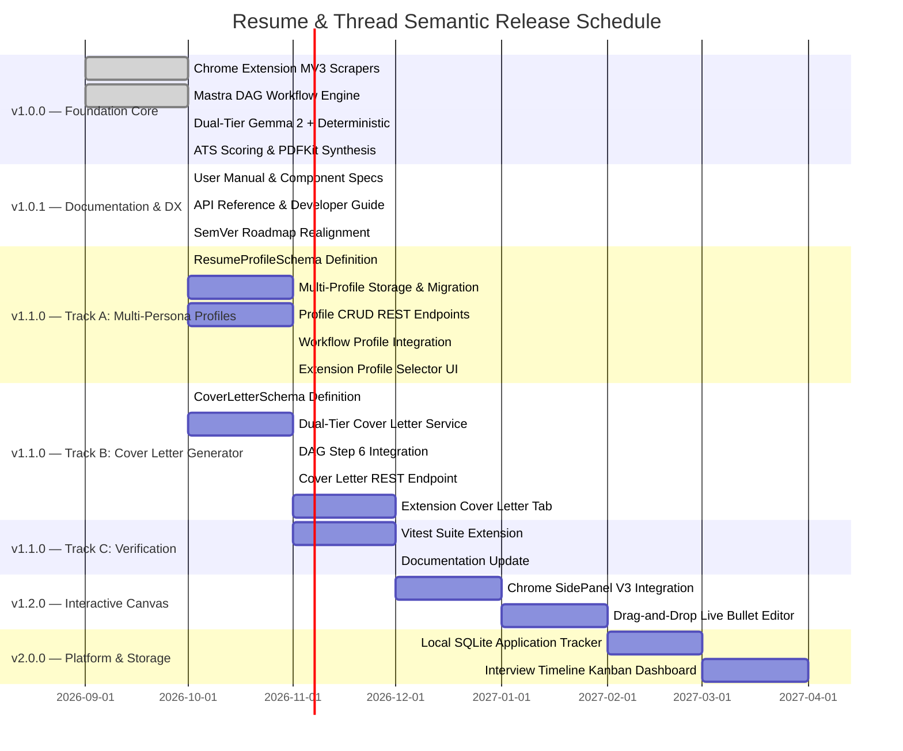
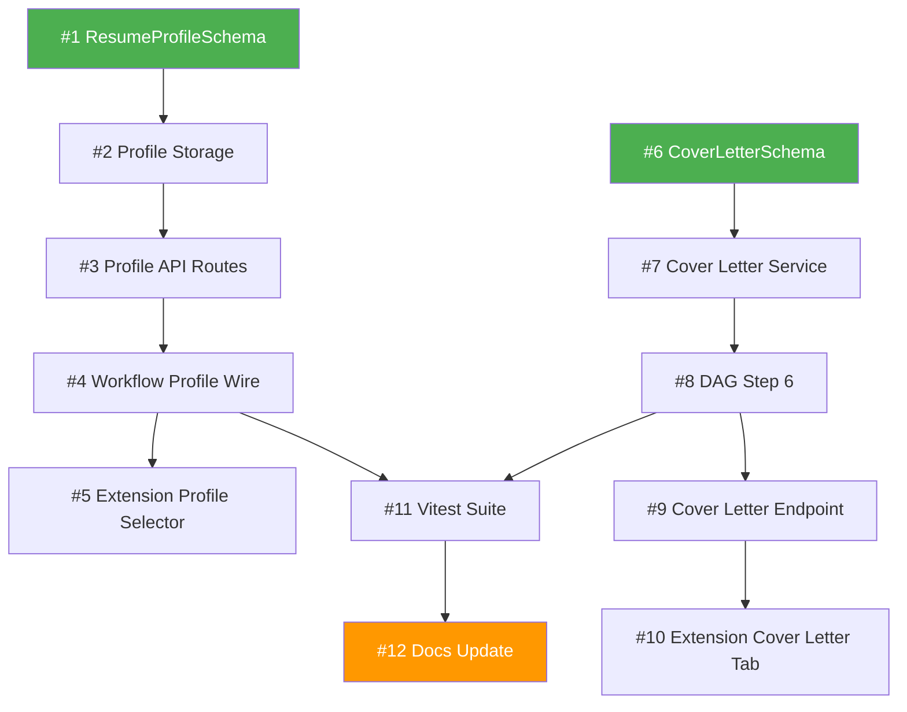

# Resume & Thread: Unified Platform Roadmap & Release Milestones

## 1. SemVer Release Architecture

Resume & Thread liberates job applicants from recurring SaaS resume builder subscription models by delivering a high-speed, 100% private, locally orchestrated alternative.



---

## 2. Release Milestone Deliverables

### `v1.0.0` — Foundation Core ✅ Completed

- Complete Manifest V3 extension with multi-portal scrapers (LinkedIn, Indeed, Greenhouse, Lever, Ashby, Workday).
- Localhost Express gateway at `127.0.0.1:4141` with CORS origin filtering.
- Dual-tier local inference (Google Gemma 2 via Ollama with automated sub-5ms embedded AST fallback).
- Mathematical ATS scoring model (Keyword Coverage, Action Verb Density, Metric Ratio).
- Single-column ATS PDF generator and Markdown exporter.
- Vitest unit testing suite (10/10 tests passing).

### `v1.0.1` — Documentation & Developer Experience ✅ Completed

- Operational user walkthrough with button-by-button UI flows.
- Subsystem component specifications (`ats-scorer`, `gemma-runner`, `pdf-generator`, `storage-portal`).
- Full 8-endpoint API reference matrix.
- Dedicated developer guide covering Vitest, TypeScript, and Chrome MV3 debugging.
- SemVer roadmap realignment replacing ambiguous phase naming.

---

### `v1.1.0` — Advanced Personalization & Cover Letters 🔵 Active

Two independent feature tracks developed in parallel, converging in a shared verification phase.

#### Track A — Multi-Persona Resume Profiles

Named resume versions (e.g., *Frontend Architect* vs. *Distributed Backend Engineer*) selectable from the extension popup, stored locally in a profile collection format.

| # | Issue | Scope | Key Files |
|---|---|---|---|
| 1 | `feat(schema): define ResumeProfileSchema with named persona support` | New `ResumeProfileSchema` and `ProfileCollectionSchema` Zod definitions with UUID identifiers, `isDefault` flag, and timestamp metadata | `server/src/schemas/index.ts` |
| 2 | `feat(storage): build multi-profile persistence layer with migration` | Refactor storage from single `master_resume.json` to `profiles.json` collection. Auto-migrate legacy files. Atomic write with temp-file swap. Full CRUD: `loadProfileCollection`, `getProfileById`, `getActiveProfile`, `setActiveProfile`, `createProfile`, `updateProfile`, `deleteProfile` | `server/src/services/storage.ts` |
| 3 | `feat(api): expose profile CRUD endpoints` | Six new REST routes (`GET/POST /api/profiles`, `GET/PATCH/DELETE /api/profiles/:id`, `POST /api/profiles/:id/activate`). Existing `/api/resume/master` becomes a backwards-compatible proxy to the active profile | `server/src/index.ts` |
| 4 | `feat(workflow): wire profile selection into tailor pipeline` | `TailorRequestSchema` accepts optional `profileId`. If provided without `masterResume`, the workflow loads the profile's resume from storage. Response metadata includes `profileId` and `profileName` | `server/src/schemas/index.ts`, `server/src/mastra/workflows/tailor-workflow.ts`, `server/src/index.ts` |
| 5 | `feat(extension): add profile selector dropdown to popup UI` | Dropdown populated via `GET /api/profiles` on popup load. Selected profile ID passed through to the tailor request. "Manage Profiles" link for CRUD operations | `extension/popup/` |

**Dependency chain**: `#1 → #2 → #3 → #4 → #5`

#### Track B — Contextual Cover Letter Generator

Dual-tier cover letter synthesis (Gemma 2 neural + deterministic template fallback) producing grounded 3-paragraph cover letters from the tailored resume and job specification.

| # | Issue | Scope | Key Files |
|---|---|---|---|
| 6 | `feat(schema): define CoverLetterSchema and generation parameters` | `CoverLetterSchema` (greeting, opening, body, closing, signOff, fullText, metadata) and `CoverLetterOptionsSchema` (tone, emphasize, companyValues, maxWords) | `server/src/schemas/index.ts` |
| 7 | `feat(ai): build cover letter generator service with dual-tier inference` | Neural path: structured prompt to Gemma 2 using top resume highlights and matched keywords. Deterministic fallback: template interpolation producing valid output in <5ms when Ollama is offline | `server/src/services/cover-letter-generator.ts` (new) |
| 8 | `feat(workflow): add generateCoverLetterStep as DAG Step 6` | Optional step triggered by `includeCoverLetter: true` in workflow options. Runs in parallel with PDF/Markdown artifact synthesis. `TailorResponseSchema` extended with optional `coverLetter` field | `server/src/mastra/workflows/tailor-workflow.ts`, `server/src/schemas/index.ts` |
| 9 | `feat(api): add dedicated cover letter generation endpoint` | `POST /api/cover-letter` accepting `{ tailoredResume, jobSpec, options }` for standalone generation without re-running the full DAG | `server/src/index.ts` |
| 10 | `feat(extension): add cover letter tab to results view` | "Also generate cover letter" checkbox, tabbed results (Resume / Cover Letter / ATS Score), tone selector dropdown, copy-to-clipboard | `extension/popup/` |

**Dependency chain**: `#6 → #7 → #8 → #9 → #10`

#### Track C — Verification & Documentation

| # | Issue | Scope | Key Files |
|---|---|---|---|
| 11 | `test(v1.1.0): extend Vitest suite for profiles and cover letters` | New test files: `profile-storage.test.ts` (CRUD, migration, deletion guard), `cover-letter-generator.test.ts` (both inference paths, schema validation), `tailor-workflow-v11.test.ts` (profile-aware tailoring, cover letter step) | `server/src/__tests__/` |
| 12 | `docs(v1.1.0): update documentation for multi-persona and cover letter features` | Updated README walkthrough, updated API reference with new endpoints, new component specs (`cover-letter-generator.md`, `profile-manager.md`), roadmap status update | `README.md`, `docs/` |

**Dependencies**: `#11` requires both Track A (#4) and Track B (#8). `#12` requires `#11`.

#### v1.1.0 Dependency Graph



#### v1.1.0 Updated Pipeline (Post-Completion)

```
Trigger
  → normalizeJobSpecStep         [Keyword extraction & normalization]
  → analyzeSkillDeltaStep        [Gap analysis against profile resume]
  → executeResumeAdaptation      [Dual-tier Gemma 2 / AST inference]
  → calculateAtsScore            [3-factor composite scoring]
  → generateResumePdf            ┐
  → generateResumeMarkdown       ├─ Parallel artifact synthesis
  → generateCoverLetterStep      ┘  (optional, if requested)
```

---

### `v1.2.0` — Interactive SidePanel & Canvas

- **Chrome SidePanel V3**: Persistent dockable side panel allowing side-by-side editing directly adjacent to job listings. The panel persists across tab navigation within the same domain, maintaining the active tailoring session.
- **Live Diff Canvas**: Interactive bullet point re-ordering with drag-and-drop. Each reorder triggers real-time ATS score recalculation, giving immediate visual feedback on how structural changes affect compatibility.

### `v2.0.0` — Local Application Intelligence & Kanban

- **Local Application Store**: SQLite persistence logging tailored resumes, submission dates, job URLs, ATS compatibility scores, and the profile used for each application. Full-text search across historical applications.
- **Job Tracker Kanban**: Drag-and-drop dashboard tracking applications across *Applied*, *Screening*, *Technical Interview*, *Offer*, and *Archived* stages. Timeline view with automatic status aging alerts.
