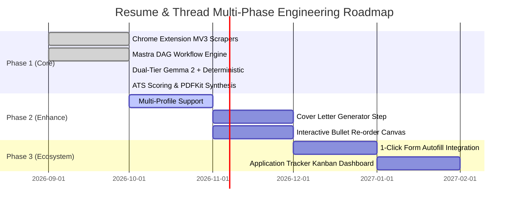

# Resume & Thread: Unified Platform Architecture & Development Roadmap

## 1. Multi-Phase Vision

Resume & Thread liberates job applicants from the recurring $20–$40/month SaaS resume builder subscription cycle by delivering a high-speed, 100% private, local-orchestrated alternative. 

---

## 2. Milestone Deliverables

### Phase 1: MVP & Foundation (Current)
- Complete Manifest V3 extension with multi-portal scrapers (LinkedIn, Indeed, Greenhouse, Lever, Ashby, Workday).
- Local Mastra orchestration server with Zod schema verification.
- Dual-tier local inference (Google Gemma 2 via Ollama with automated deterministic fallback).
- Single-column ATS PDF generator and Markdown synthesizer.
- 10/10 Vitest unit test suite passed.

### Phase 2: Enhanced Customization & Formats
- Multiple resume versions (e.g. Frontend vs Distributed Backend profiles).
- Modular cover letter generator step using matching qualification taxonomies.
- Side-panel diff viewer with bullet point drag-and-drop.

### Phase 3: Automated Workflow & Local Intelligence
- One-click application autofill using extracted qualifications.
- Local SQLite job application tracker with interview timeline Kanban.
- Cross-platform desktop native runner bundling Ollama with zero setup.
