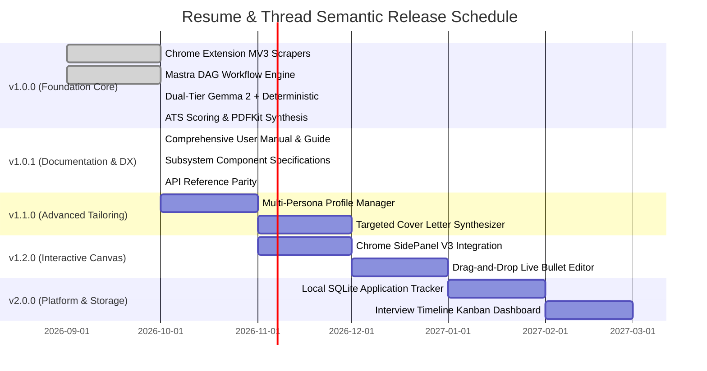

# Resume & Thread: Unified Platform Roadmap & Release Milestones

## 1. SemVer Release Architecture

Resume & Thread liberates job applicants from recurring SaaS resume builder subscription models by delivering a high-speed, 100% private, locally orchestrated alternative.

---

## 2. Release Milestone Deliverables

### `v1.0.0` — Foundation Core (Completed)
- Complete Manifest V3 extension with multi-portal scrapers (LinkedIn, Indeed, Greenhouse, Lever, Ashby, Workday).
- Localhost Express gateway at `127.0.0.1:4141` with CORS origin filtering.
- Dual-tier local inference (Google Gemma 2 via Ollama with automated sub-5ms embedded AST fallback).
- Mathematical ATS scoring model (Keyword Coverage, Action Verb Density, Metric Ratio).
- Single-column ATS PDF generator and Markdown exporter.
- Vitest unit testing suite (10/10 tests passing).

### `v1.0.1` — Documentation & Developer Experience (Current)
- Operational user walkthrough with button-by-button UI flows.
- Subsystem component specifications (`ats-scorer`, `gemma-runner`, `pdf-generator`, `storage-portal`).
- Full 8-endpoint API reference matrix.
- Dedicated developer guide covering Vitest, TypeScript, and Chrome MV3 debugging.

### `v1.1.0` — Advanced Personalization & Cover Letters (Next Milestone)
- **Multi-Persona Profiles**: Support for multiple resume versions (e.g. *Frontend Architect* vs. *Distributed Backend Engineer*) selectable from the extension popup.
- **Contextual Cover Letter Generator**: Additional Mastra workflow DAG step producing tailored, grounded 3-paragraph cover letters matching company culture and job requirements.

### `v1.2.0` — Interactive SidePanel & Canvas
- **Chrome SidePanel V3**: Persistent dockable side panel allowing side-by-side editing directly adjacent to job listings.
- **Live Diff Canvas**: Interactive bullet point re-ordering with real-time ATS score recalculation.

### `v2.0.0` — Local Application Intelligence & Kanban
- **Local Application Store**: SQLite persistence logging tailored resumes, submission dates, job URLs, and ATS compatibility scores.
- **Job Tracker Kanban**: Drag-and-drop dashboard tracking applications across *Applied*, *Screening*, *Technical Interview*, *Offer*, and *Archived*.
