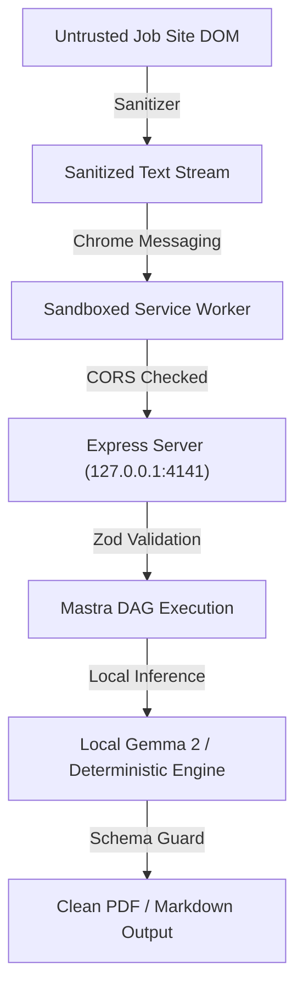

# Security Threat Model: Resume & Thread

## 1. Threat Matrix

| Threat ID | Threat Description | Attack Vector | Severity | Mitigation Strategy |
|---|---|---|---|---|
| **THREAT-01** | Cross-Origin Data Exfiltration | Malicious web page sends `fetch('http://127.0.0.1:4141/api/resume/master')` | **High** | Strict CORS policy allowing only `chrome-extension://*` origins. Explicit host binding to loopback (`127.0.0.1`). |
| **THREAT-02** | Malicious Job Description Payload (XSS) | Attacker embeds `<script>` in job board DOM | **Medium** | Content Script strips all HTML tags, scripts, and entities before passing text to orchestrator. |
| **THREAT-03** | LLM Prompt Injection via Job Requirements | Malicious job posting text attempts prompt escape | **Medium** | Gemma 2 turn formatting `<start_of_turn>user ... <end_of_turn>` isolates untrusted context. Output strictly constrained to Zod JSON schema. |
| **THREAT-04** | Local Storage Tampering | Malicious extension attempts to read `chrome.storage.local` | **Low** | Chrome Extension runtime sandbox isolates extension storage from non-extension processes. |

---

## 2. Security Mitigation Architecture

